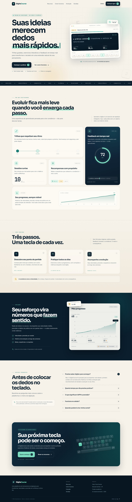
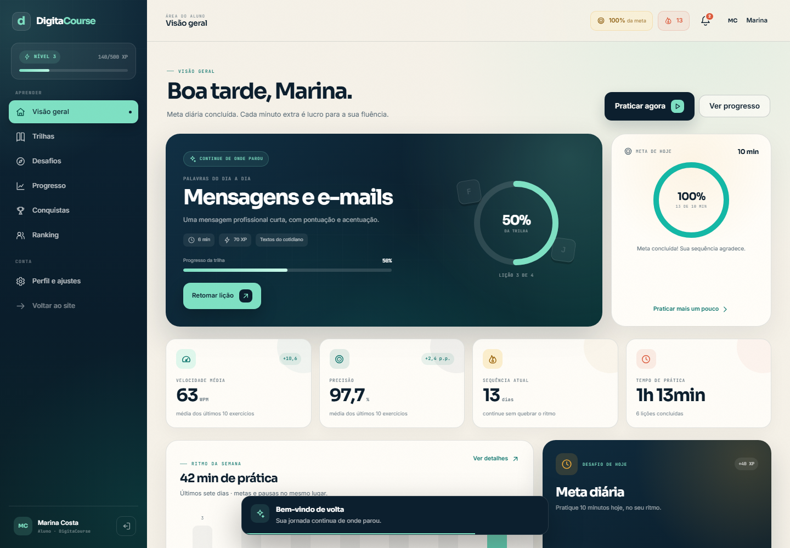

# DigitaCourse

Plataforma de treinamento de digitação criada para transformar velocidade e precisão em confiança no dia a dia. O projeto é acadêmico, desenvolvido no contexto da Fatec Praia Grande (Baixada Santista/SP), e está sendo construído por etapas.

> **Status atual:** Etapa 03 concluída — API Spring Boot + PostgreSQL, autenticação JWT e persistência real de contas, catálogo, progresso, preferências e notificações.





## O que existe hoje

- Landing page pública, responsiva e em português (pt-BR).
- Cadastro, login e sessão real com API Spring Boot, senhas BCrypt e JWT.
- Conta de demonstração com três trilhas, doze lições, progresso, tentativas e notificações persistidos.
- Catálogo de trilhas, módulos e lições armazenado no PostgreSQL e servido por `GET /api/catalog`.
- Painel do aluno com próxima lição, meta diária, estatísticas e atividade semanal.
- Detalhe da trilha com lições bloqueadas por progresso.
- Motor de prática de digitação com WPM, precisão, erros, tempo e XP em tempo real.
- Progresso com gráfico de evolução, heatmap, atividade semanal e histórico.
- Desafios, conquistas, ranking e central de notificações.
- Perfil com nome, meta diária, preferências, redefinição de progresso e restauração da conta demo.
- Layout responsivo, menu mobile, modo focado de prática e página 404.
- Metadados de página por rota e animações com respeito a `prefers-reduced-motion`.
- API com Flyway, validação, tratamento centralizado de erros, health check e 25 verificações automatizadas.
- Interface validada em navegador real com 27 verificações e dezessete capturas da Etapa 03.

## Rotas principais

| Rota | Acesso | Tela |
| --- | --- | --- |
| `/` | Pública | Landing page |
| `/entrar` | Pública | Login |
| `/cadastro` | Pública | Criação de conta |
| `/recuperar-senha` | Pública | Recuperação (envio de e-mail ainda não habilitado) |
| `/app` | Protegida | Painel do aluno |
| `/app/trilhas` | Protegida | Trilhas |
| `/app/trilhas/:courseId` | Protegida | Detalhe da trilha |
| `/app/praticar/:lessonId` | Protegida | Prática em modo focado |
| `/app/progresso` | Protegida | Progresso |
| `/app/desafios` | Protegida | Desafios |
| `/app/conquistas` | Protegida | Conquistas |
| `/app/ranking` | Protegida | Ranking |
| `/app/notificacoes` | Protegida | Notificações |
| `/app/perfil` | Protegida | Perfil e ajustes |
| `*` | Pública | Página 404 |

## Arquitetura

```text
React + Vite (:5173)
        │  HTTP/JSON + Bearer JWT
        ▼
Spring Boot (:8080) /api
        │  JPA + HikariCP
        ▼
PostgreSQL (:5432) / digitacourse
```

Em desenvolvimento, o Vite faz proxy de `/api` para a API. O token JWT é a única informação de sessão no navegador.

## Estrutura do repositório

```text
.
├── backend/
│   ├── src/main/java/com/digitacourse/api/
│   │   ├── config/                  # Segurança e seed da demo
│   │   ├── domain/                  # Entidades JPA
│   │   ├── repository/              # Repositórios Spring Data
│   │   ├── security/                # JWT e principal autenticado
│   │   ├── service/                 # Autenticação, conta, catálogo e demo
│   │   └── web/                     # Controllers, DTOs e tratamento de erros
│   ├── src/main/resources/
│   │   ├── application.yml          # Banco, JWT, CORS e porta
│   │   └── db/migration/            # Flyway V1 e V2
│   └── pom.xml
├── frontend/
│   ├── public/                      # Favicon e imagem Open Graph
│   ├── src/
│   │   ├── components/
│   │   │   ├── app/                 # Shell, navegação, cartões e gráficos
│   │   │   └── auth/                # Layout das telas de autenticação
│   │   ├── context/                 # Conta, sessão, progresso e toasts
│   │   ├── data/                    # Catálogo fallback e e-mail da demo
│   │   ├── hooks/                   # Metadados e animações de entrada
│   │   ├── lib/                     # Cliente HTTP, formatação e métricas
│   │   ├── pages/
│   │   │   ├── app/                 # Páginas da área do aluno
│   │   │   └── auth/                # Login, cadastro e recuperação
│   │   ├── styles/
│   │   │   ├── app.css              # Área do aluno e responsividade
│   │   │   └── global.css           # Design system e landing page
│   │   ├── App.jsx                  # Rotas e composição
│   │   └── main.jsx                 # Router, providers e fontes
│   ├── index.html
│   ├── package.json
│   └── vite.config.js               # Proxy /api
├── docs/
│   ├── assets/
│   │   ├── etapa-01/
│   │   ├── etapa-02/
│   │   └── etapa-03/
│   ├── etapas/
│   │   ├── etapa-01-pagina-inicial.md
│   │   ├── etapa-02-area-do-aluno.md
│   │   └── etapa-03-banco-de-dados.md
│   └── README.md
└── Cronograma_DigitaCourse/         # Artefatos de planejamento do projeto
```

## Como executar

Requisitos: **JDK 21**, **Maven 3.9+**, **PostgreSQL 17** e **Node.js 20+** com npm. As ferramentas podem ser portáteis.

### 1. PostgreSQL

Na primeira vez, criar o cluster local:

```bash
initdb -D pgdata -U postgres --auth=trust --encoding=UTF8
```

Iniciar o servidor:

```bash
pg_ctl -D pgdata -l pgdata.log -o "-p 5432" start
```

Criar o banco:

```bash
createdb -h 127.0.0.1 -p 5432 -U postgres digitacourse
```

> `--auth=trust` é adequado apenas para desenvolvimento local.

### 2. API

```bash
cd backend
mvn spring-boot:run
```

A API sobe em `http://127.0.0.1:8080/api`. O Flyway aplica o schema e o catálogo automaticamente.

Health check:

```bash
curl http://127.0.0.1:8080/api/health
```

### 3. Front-end

```bash
cd frontend
npm install
npm run dev
```

Acesse `http://localhost:5173`.

> No PowerShell do Windows, use `npm.cmd` caso a execução de `npm.ps1` esteja bloqueada pela política de scripts.

### Variáveis de ambiente

| Variável | Padrão | Função |
| --- | --- | --- |
| `DIGITACOURSE_DB_URL` | `jdbc:postgresql://127.0.0.1:5432/digitacourse` | URL JDBC |
| `DIGITACOURSE_DB_USER` | `postgres` | Usuário do banco |
| `DIGITACOURSE_DB_PASSWORD` | vazio | Senha do banco |
| `DIGITACOURSE_JWT_SECRET` | Chave local de desenvolvimento | Assinatura do JWT |
| `PORT` | `8080` | Porta da API |
| `VITE_API_URL` | `/api` | Base da API no front-end |

Em produção, defina uma chave JWT forte (32+ caracteres), use senha no PostgreSQL e sirva a API por HTTPS.

## Conta de demonstração

```text
E-mail: marina@digitacourse.com
Senha:  demo1234
```

Também é possível clicar em **Entrar com conta de demonstração** na tela de login.

A demo começa com 21 tentativas, 6 lições concluídas, sequência de 13 dias, meta de 10 minutos e 4 notificações. Para restaurar o estado original, use **Perfil → Restaurar conta demo** ou:

```bash
curl -X POST http://127.0.0.1:8080/api/auth/demo/restore
```

## Build de produção

Backend:

```bash
cd backend
mvn -B -DskipTests package
java -jar target/digitacourse-api-0.3.0.jar
```

Front-end:

```bash
cd frontend
npm run build
npm run preview
```

O build do front-end é gerado em `frontend/dist`. Para publicar a SPA, o host precisa redirecionar rotas desconhecidas para `index.html`.

## Stack

| Camada | Tecnologia |
| --- | --- |
| Interface | React 18.3.1 |
| Rotas | React Router DOM 7.18.6 |
| Build/dev server | Vite 8.3.8 |
| Estilos | CSS puro com design tokens |
| Estado | Context API + cliente HTTP |
| API | Spring Boot 3.4.5 / Java 21 |
| Persistência | PostgreSQL 17 + Spring Data JPA |
| Migrações | Flyway |
| Autenticação | JWT + BCrypt |
| Build da API | Maven 3.9 |
| Fontes | Sora, Inter e JetBrains Mono via Fontsource (self-hosted) |
| Ícones | SVG inline, sem biblioteca externa |

## Escopo e limites

- A área administrativa não foi solicitada e permanece fora de escopo.
- O envio real de e-mail, a verificação de conta e a recuperação de senha por e-mail ainda não estão implementados.
- O ranking continua fictício e calculado no cliente.
- O endpoint de restauração da demo é um atalho de desenvolvimento e deve ser protegido antes de produção.
- O JWT fica no `localStorage` nesta etapa; uma aplicação de produção deve avaliar cookie `HttpOnly` + CSRF, refresh token e revogação de sessão.
- Não há rate limiting, auditoria de acessibilidade automatizada ou pipeline de deploy configurados.

## Documentação

- [Índice geral da documentação](docs/README.md)
- [Etapa 01 — Página inicial](docs/etapas/etapa-01-pagina-inicial.md)
- [Etapa 02 — Área do aluno](docs/etapas/etapa-02-area-do-aluno.md)
- [Etapa 03 — Banco de dados, autenticação e persistência](docs/etapas/etapa-03-banco-de-dados.md)

## Próximos passos previstos

1. Validação da Etapa 03 com o orientador e publicação de uma prévia.
2. Proteção do endpoint de restauração da demo, rotação da chave JWT e HTTPS.
3. Verificação de e-mail, recuperação de senha real e refresh token.
4. Rate limiting, revogação de sessão e endurecimento da autenticação.
5. Ranking real, notificações por e-mail e área administrativa.
6. Testes versionados, lint, auditoria de acessibilidade e deploy com fallback de SPA.

---

Projeto acadêmico · Fatec Praia Grande · 2026
